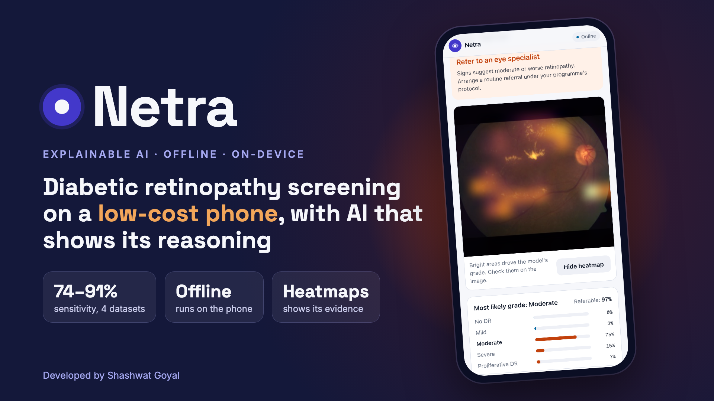

# Netra



**Offline diabetic retinopathy screening on a low-cost phone, with AI that shows its reasoning.**

**Live app:** https://netra-three-gamma.vercel.app · **Demo video (1:30):** [`demo/netra-demo.mp4`](demo/netra-demo.mp4)

India has over 77 million adults with diabetes and roughly one ophthalmologist per 100,000 rural people. Diabetic retinopathy (DR) is a leading cause of preventable blindness: caught early, most vision loss can be avoided, but screening needs specialists who aren't there. Netra lets a health worker photograph the retina, get a referral decision with an explanation in seconds, and track that referral, all on an ordinary Android phone with no internet connection.

The problem comes from Smart India Hackathon 2026 statement **SIH26038** (MathWorks), *Explainable AI for Diabetic Retinopathy Screening in Rural India*.

## What it does

- **Grades DR on the standard 5-level scale** (none, mild, moderate, severe, proliferative) and turns that into a **refer / don't-refer decision**. "Referable" means moderate or worse, the line international screening guidance draws.
- **Shows why.** A heatmap over the photo marks the regions that drove the grade, so the health worker and the receiving specialist can check the model's reasoning. It marks regions, not individual lesions.
- **Works offline.** The model runs inside the app on the phone itself. After the first visit, screening needs no network at all.
- **Keeps data on the device.** Photos and results are stored only in the phone's browser storage. There is no server and no upload.
- **Checks photo quality** for blur, exposure and framing before analysis, and asks for a retake.
- **Tracks referrals.** A queue sorted by urgency, a status flow (needs referral → referred → seen), notes, and CSV export for programme reporting.
- **Reports its own accuracy.** A model page in the app shows sensitivity, specificity, ROC curve, confusion matrix and external results for the exact model file it runs.

## Results

The shipped model is **DINOv3 ConvNeXt-Tiny** fine-tuned on **APTOS 2019** (Aravind Eye Hospital, India) and **DDR** (147 hospitals, China): 9,189 training photos. Every number below comes from the 56 MB model file the app runs, through the app's own preprocessing and referral rule. The referral threshold was set once, on validation data, to catch at least 90% of referable disease, and was never retuned for any test set.

| Test set | Photos (referable) | Sensitivity | Specificity | AUC | Grading κ |
|---|---|---|---|---|---|
| APTOS held-out test (India) | 367 (149) | **91.3%** | 91.7% | 0.977 | 0.900 |
| DDR held-out test (China)¹ | 3,759 (1,690) | **73.8%** | 95.1% | 0.941 | 0.778 |
| **IDRiD (India), never seen** | 516 (323) | **84.8%** | 82.9% | 0.935 | 0.721 |
| **Messidor-2 (France), never seen**² | 1,744 (457) | **89.7%** | 69.1% | 0.894 | 0.541 |

¹ DDR's training split is in the training data, so this row is held-out photos from hospitals the model has seen, not a new site.
² Graded by Google's adjudication panel.

### Why two training sources

The first model, trained on APTOS alone, scored 95.3% sensitivity on its own test set, then caught **37%** of referable eyes at DDR's hospitals and **34%** on Messidor-2. Almost all of the misses were moderate disease on cameras it had never seen. Training on both sources gave up a few points on APTOS for reliability everywhere else:

| Sensitivity | APTOS only | APTOS + DDR (shipped) |
|---|---|---|
| APTOS test | 95.3% | 91.3% |
| DDR test | 37.0% | 73.8% |
| IDRiD | 80.8% | 84.8% |
| Messidor-2 | 33.9% | 89.7% |

The cost is more false referrals at some sites (69% specificity on Messidor-2). For a screening tool, a false referral costs a clinic visit and a miss can cost an eye, so that is the safer way to be wrong.

## How it works

```
On the phone, offline                            Trained once, on a laptop
──────────────────────                           ─────────────────────────
retina photo                                     APTOS + DDR, 9,189 photos
  → crop + quality check                           → fine-tune (PyTorch, bf16, Apple GPU)
  → DINOv3 ConvNeXt-Tiny (ONNX Runtime Web)        → export ONNX, fp16 weights
  → grade 0–4 + heatmap, one forward pass          → evaluate on 4 test sets
  → referral rule → saved on the device            → ship into web/public/model
```

**Backbone.** DINOv3 ConvNeXt-Tiny (Meta, 2025), distilled from a 7-billion-parameter self-supervised model trained on 1.7 billion images, and still small enough (28M parameters) for a phone. EfficientNet-B0 (2019) was ruled out as outdated. ConvNeXt V2-Nano was set up for comparison but dropped: the weakness turned out to be training data, not architecture, and its weights are licensed non-commercial only.

**Exact heatmaps, no gradients.** The backbone ends in global-average-pool → LayerNorm → linear. Each grade's score can then be rewritten exactly as the spatial mean of `Σₖ W[c,k]·γₖ·(Aₖ(h,w) − μ)/σ`, which is the heatmap. The phone gets it from the same single forward pass that produces the grade. `export.py` asserts that the maps reproduce the model's scores.

**fp16 weights, not int8.** Static and dynamic int8 quantization both cost ConvNeXt real accuracy. Storing weights in fp16 and casting back to fp32 on load halves the download (111 → 56 MB) and changes probabilities by less than 0.0001.

**The phone matches the lab.** The app reimplements PIL's bilinear resize instead of relying on canvas smoothing, which had drifted predictions by up to 10 points. On real test photos, the app and `evaluate.py` give the same grade and the same referral decision (checked with `parity.py`).

**Safety rule.** The app refers whenever the referable probability reaches the threshold, *or* the most likely grade is moderate or worse, so it can never show a referable grade next to a "no referral" verdict. `evaluate.py` applies the same rule, so the reported numbers describe what the app does.

**Offline, downloaded once.** The app is a static site. On the first visit the page downloads the model once, with a progress bar, and keeps it in the browser's cache under its version. A service worker caches the app and the ONNX Runtime files. A new model version is picked up automatically the next time the phone is online.

## Repository

```
ml/                 training, evaluation and export (Python, uv)
  download.py         APTOS 2019 via the Kaggle API
  prepare.py          crop, cache and split the photos
  train.py            fine-tune; full checkpoint every epoch, --resume
  export.py           ONNX with exact heatmaps, fp16 weights
  evaluate.py         held-out test through the app's own rule; sets the threshold
  external.py         DDR, IDRiD and Messidor-2, no retuning
  parity.py           browser-vs-Python agreement check
  ship.py             copy the model into the app, bump the offline cache
  run_all.sh          prepare → train → export → evaluate → external
  pause.sh            freeze a long run in place; `pause.sh resume`
web/                the app (Next.js static export, installable PWA)
  app/                screening, referrals, records, model page
  lib/                preprocessing, inference, heatmaps, on-device storage
  public/model/       the shipped model and its evaluation results
  public/sw.js        offline support
demo/               demo video
```

## Run it

### The app

```bash
cd web
pnpm install     # also copies the ONNX Runtime files into public/ort
pnpm dev         # http://localhost:3000
pnpm build       # static site in web/out, host anywhere over HTTPS
```

The trained model is already in `web/public/model`, so the app runs without the ML side.

**Deploying.** The live app is on Vercel: import the repository, set **Root Directory** to `web`, and leave the defaults. Every push to `main` redeploys. `web/vercel.json` stops browsers from holding on to an old service worker or model.

**On a phone.** Open the site in Chrome on Android and choose **Install app**. The first visit downloads the 56 MB model once; after that it works in airplane mode.

### Retraining the model

Needs a Kaggle account with `~/.kaggle/kaggle.json` in place, the [APTOS 2019 rules](https://www.kaggle.com/c/aptos2019-blindness-detection/rules) accepted, and about 40 GB of free disk while downloading (25 GB once unpacked).

```bash
cd ml
uv sync
uv run python download.py                       # APTOS 2019 into data/raw

# DDR (training + its test split), IDRiD and Messidor-2 (external tests)
uv run kaggle datasets download samriddhibagchi/ddr-dataset-credits-to-authors -p data/ddr_full
#   unzip DR_grading/{train,valid} and their .txt files into data/ddr_full,
#   and DR_grading/test + test.txt into data/ddr
uv run kaggle datasets download aaryapatel98/indian-diabetic-retinopathy-image-dataset -p data/idrid --unzip
uv run kaggle datasets download google-brain/messidor2-dr-grades -p data/messidor2 --unzip
uv run kaggle datasets download xyaustin/messidor2 -p data/messidor2 --unzip

./run_all.sh 8 dinov3                           # ~7.5 h on an Apple M5; pause.sh to stop for the night
uv run python ship.py --model dinov3            # put the new model into the app
```

## What has been tested

- Full screening in the deployed app, then again with all network traffic blocked: same result, records saved.
- The model downloads exactly once, with visible progress.
- Browser and Python give identical grades and referral decisions on real test photos.
- Typecheck, lint and production build pass.

**Not yet tested:** a physical Android phone. Everything above ran in Chrome on a Mac, at phone size.

## Limits

Netra is a screening aid, not a diagnosis, and it has not been clinically validated. Performance varies by site: 74% to 91% sensitivity across the four test sets, with specificity as low as 69%. Any clinic should validate it on its own camera and population first. It does not detect other eye diseases or grade macular edema separately, and the heatmaps mark regions rather than individual lesions. A trained grader or ophthalmologist must confirm every referral.

## Data and credits

- **APTOS 2019 Blindness Detection** (Aravind Eye Hospital), Kaggle competition data.
- **DDR** (Li et al., 2019, "Diagnostic assessment of deep learning algorithms for diabetic retinopathy screening").
- **IDRiD** (Porwal et al., 2018), CC BY 4.0.
- **Messidor-2**, with Google's adjudicated grades (Krause et al., 2018), CC0.
- **DINOv3** pretrained weights, Meta, under the DINOv3 license.

---

Developed by **Shashwat Goyal**.
